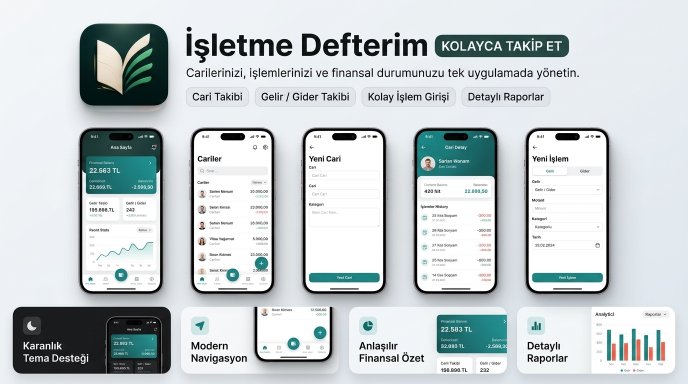

<div align="center">
  
  <h1>İşletme Defterim</h1>
  <p><strong>KOLAYCA TAKİP ET</strong></p>
  <p>Küçük işletmeler, esnaflar ve serbest çalışanlar için modern, hızlı ve güvenilir cari, gelir-gider ve kasa takip uygulaması.</p>

  <p>
    
    
    
    
    
    
  </p>

  <br />
  
  <br /><br />
</div>

---

## 📱 Proje Hakkında

**İşletme Defterim**, geleneksel veresiye ve kasa defterlerinin karmaşasını ortadan kaldıran, kullanıcı dostu bir mobil işletme asistanıdır. Masaüstünden veya mobilden tek dokunuşla cari ekleme, satış/alış kaydetme, tahsilat yapma ve yaklaşan vadeleri anlık bildirimlerle hatırlatma yeteneklerine sahiptir.

Uygulama **PWA (Progressive Web App)** ve **TWA (Trusted Web Activity)** mimarisiyle inşa edilmiştir; hem web üzerinden anında çalışır hem de Google Play Store üzerinden doğrudan Android cihazlara yerel bir uygulama gibi yüklenebilir.

---

## ✨ Temel Özellikler

### 👥 1. Cari Hesap & Müşteri Takibi
- Müşteri ve tedarikçi bazlı borç-alacak bakiyesi.
- Tek dokunuşla telefonla arama ve WhatsApp ile bakiye paylaşımı.
- Her cariye özel işlem geçmişi, tahsilat dökümü ve not alanı.

### 💰 2. Kolay & Hızlı İşlem Girişi
- **4 Temel İşlem Türü:** Satış (Alacak), Alış (Borç), Tahsilat (Kasa Girişi) ve Ödeme (Kasa Çıkışı).
- **Esnaf Hesaplayıcı:** Adet × Birim Fiyat ve m² × Birim Fiyat otomatik tutar hesaplama.
- **Hızlı Ödeme:** 50 ₺, 100 ₺, 500 ₺ ve 1.000 ₺ hazır tuşlarıyla saniyeler içinde kasa hareketi ekleme.

### 🔔 3. Vade Hatırlatıcısı & Sistem Bildirimleri
- Web Notification API entegrasyonu ile cihaz düzeyinde gerçek bildirimler.
- Vadesi gelen veya geciken alacaklar için otomatik günlük hatırlatma.
- Ayarlar menüsünden tek tuşla bildirim izni verme ve test etme imkânı.

### 📦 4. Veri Güvenliği, Yedekleme & Excel Desteği
- **Excel / CSV Dışa Aktarma:** İşlemlerinizi ve carilerinizi Microsoft Excel uyumlu (UTF-8 BOM) formatta tek tıkla indirin.
- **Tam JSON Sistem Yedeği:** Tüm veritabanınızı tek bir dosya olarak dışa aktarın ve başka bir cihaza saniyeler içinde geri yükleyin.
- **Toplu Cari Yükleme:** Excel veya rehberden hazırlanan CSV dosyalarını sisteme toplu içe aktarma.

### 🌓 5. Koyu / Açık Tema Desteği
- Gece ve gündüz kullanımına uygun, gözü yormayan modern açık ve koyu tema seçenekleri.
- Tercihler yerel hafızada saklanır ve oturumlar arasında korunur.

### ☁️ 6. Firebase Bulut Senkronizasyonu
- Google Cloud Firestore güvencesiyle çoklu cihaz desteği.
- Telefon, tablet ve bilgisayar arasında eş zamanlı canlı veri akışı.

---

## 🛠️ Teknoloji Yığını

| Katman | Teknoloji | Açıklama |
| :--- | :--- | :--- |
| **Ön Yüz (Frontend)** | React 19, JavaScript (ESNext) | Modern bileşen mimarisi ve state yönetimi |
| **Derleyici (Build)** | Vite 8 | Ultra hızlı HMR ve optimize üretim paketi |
| **Stil & Arayüz** | CSS3 (Modern Variables & Flex/Grid) | Özel mobil UI tasarımı, responsive & akıcı geçişler |
| **Veritabanı & Kimlik** | Firebase Auth & Cloud Firestore | Gerçek zamanlı senkronizasyon ve kullanıcı bazlı güvenlik kuralları |
| **Mobil / PWA** | Vite Plugin PWA, Workbox | Çevrimdışı çalışma, servis çalışanı ve Android TWA uyumluluğu |

---

## 📁 Proje Dizin Yapısı

```text
amcam-defter/
├── public/                     # Statik varlıklar ve ikonlar
│   ├── logo.png                # Resmi 512x512 marka logosu
│   ├── pwa-192x192.png         # PWA mobil ikonu
│   ├── pwa-512x512.png         # Play Store & yüksek çözünürlüklü ikon
│   ├── apple-touch-icon.png    # iOS ana ekran ikonu
│   ├── favicon.svg             # Vektörel sekme ikonu
│   └── showcase-banner.png     # Tanıtım ve portfolyo görseli
├── src/
│   ├── components/             # Yeniden kullanılabilir bileşenler
│   │   ├── Auth.jsx            # Giriş & Kayıt ekranı
│   │   └── BottomNav.jsx       # 5 sekmeli modern alt navigasyon
│   ├── pages/                  # Uygulama ekranları
│   │   ├── HomePage.jsx        # Finansal genel bakış & dashboard
│   │   ├── Customers.jsx       # Cari listesi, filtreleme & detay
│   │   ├── TransactionsPage.jsx# Tarih bazlı işlem geçmişi
│   │   ├── NewTransactionPage.jsx # Satış/Alış/Tahsilat giriş formu
│   │   ├── QuickPaymentPage.jsx# Hızlı kasa girişi / çıkışı
│   │   ├── ReportsPage.jsx     # Gelir-gider grafikleri & raporlar
│   │   ├── MenuPage.jsx        # Ayarlar, yedekleme & tema yönetimi
│   │   └── Profile.jsx         # Profil bilgileri güncelleme
│   ├── utils/                  # Yardımcı fonksiyonlar ve servisler
│   │   ├── appSettings.js      # Uygulama tercihleri ve yerel depolama
│   │   ├── exportImportHelpers.js # CSV/JSON dışa ve içe aktarım
│   │   ├── notificationService.js # Tarayıcı & cihaz bildirim servisi
│   │   └── transactionHelpers.js  # Para, tarih ve hesaplama araçları
│   ├── App.css                 # Kapsamlı mobil arayüz stilleri
│   ├── App.jsx                 # Ana uygulama ve durum yönlendirici
│   ├── firebase.js             # Firebase başlatma ve bağlantı
│   └── main.jsx                # React DOM kök girişi
├── index.html                  # Mobil meta etiketleri ve PWA bağlantıları
├── vite.config.js              # PWA manifest ve Vite konfigürasyonu
└── package.json                # Bağımlılıklar ve npm betikleri
```

---

## 🚀 Kurulum ve Yerel Geliştirme

Projeyi kendi bilgisayarınızda çalıştırmak için:

1. **Repoyu klonlayın:**
   ```bash
   git clone https://github.com/Firdevs64/isletme-defterim.git
   cd isletme-defterim
   ```

2. **Bağımlılıkları yükleyin:**
   ```bash
   npm install
   ```

3. **Çevre Değişkenlerini Tanımlayın (`.env`):**
   Ana dizinde `.env` dosyası oluşturup Firebase proje bilgilerinizi girin:
   ```env
   VITE_FIREBASE_API_KEY=your_api_key
   VITE_FIREBASE_AUTH_DOMAIN=your_project.firebaseapp.com
   VITE_FIREBASE_PROJECT_ID=your_project_id
   VITE_FIREBASE_STORAGE_BUCKET=your_project.firebasestorage.app
   VITE_FIREBASE_MESSAGING_SENDER_ID=your_sender_id
   VITE_FIREBASE_APP_ID=your_app_id
   ```

4. **Geliştirme Sunucusunu Başlatın:**
   ```bash
   npm run dev
   ```

5. **Canlı Sürüm (Production Build) Oluşturun:**
   ```bash
   npm run build
   ```

---

## 📦 Google Play Store (TWA) Dağıtımı

Uygulama, Google Play Store için **Trusted Web Activity (TWA)** veya **Capacitor** ile doğrudan `.aab` formatına dönüştürülebilir:
1. `npm run build` ile `dist/` klasörünü canlı web adresinize (Netlify / Vercel) deploy edin.
2. [PWABuilder](https://www.pwabuilder.com/) veya [Bubblewrap CLI](https://github.com/GoogleChromeLabs/bubblewrap) kullanarak tek komutla Android paketini oluşturun:
   ```bash
   bubblewrap init --manifest https://your-domain.app/manifest.webmanifest
   bubblewrap build
   ```
3. Oluşan `.aab` dosyasını Google Play Console paneline yükleyin.

---

## 🔒 Güvenlik & Gizlilik

- Kullanıcı şifreleri Firebase Authentication altyapısında şifrelenir; açık olarak saklanmaz.
- Firestore Güvenlik Kuralları ile her kullanıcı yalnızca kendi oluşturduğu verilere erişebilir.
- Hassas API anahtarları `.env` içerisinde korunur ve repoya dahil edilmez.

---

## 👩‍💻 Geliştirici

**Firdevs Köse**  
- GitHub: [@Firdevs64](https://github.com/Firdevs64)  
- LinkedIn: [linkedin.com/in/firdevs-kose](https://www.linkedin.com)

---

<div align="center">
  <sub>İşletme Defterim — Kolayca Takip Et © 2026. Tüm hakları saklıdır.</sub>
</div>
